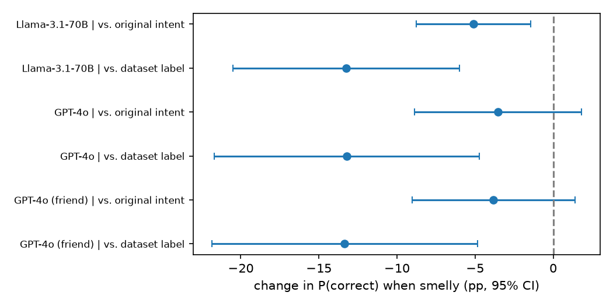
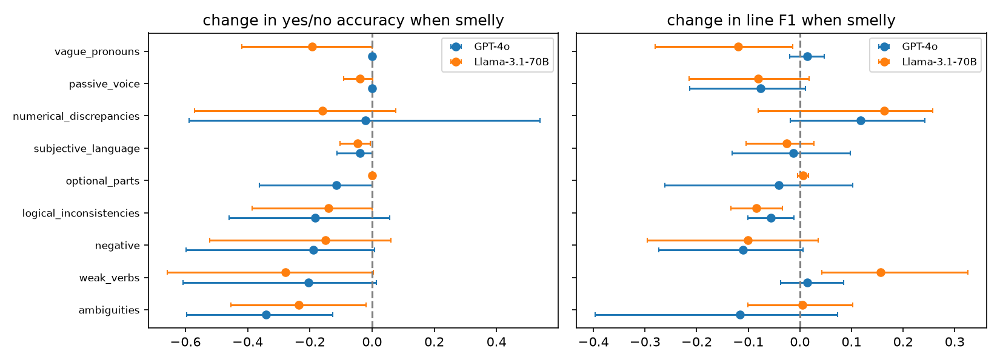

# Results: requirements smells in traceability prompts, replicated and extended

Base paper: Vogelsang et al., ICSE-NIER 2025 (arXiv 2501.04810). All numbers below are
produced by the scripts in `scripts/`; detailed tables are in `results/<step>/`.
Total cost: $0.

## Headline

1. **The paper replicates exactly** from the authors' 6,100 saved runs, and a teammate's
   550 fresh GPT-4o runs reproduce the same trend (99.2 % identical decisions on identical prompts).
2. **The "smells hurt the yes/no decision" result is mostly a scoring effect.** About 13
   points of the drop come from 10 of the 72 smelly requirements, where the smell (e.g., a
   contradiction) makes the ground truth flip to "not traceable". Models keep answering
   "implemented" 77-85 % of the time for these. Without those 10 requirements, GPT-4o shows
   **no significant drop** (-1.8 points, 95 % CI -7.1 to +3.5).
3. **Smells hurt *where* the code is located more than the paper reports**: semantic smells
   lower GPT-4o's line-level F1 by about 0.10 on the same requirements, and logical
   inconsistencies lower F1 for both models (CIs exclude 0).
4. **The paper's RQ3 table is computed incorrectly** (it mixes smelly and clean versions of
   the same requirement). Corrected, the category differences are larger than published.
5. **A rule-based detector beats a free 3B LLM** at finding smells (F1 0.63 vs. 0.45), but
   neither finds the semantic smells that matter.
6. **Smell fixer (local Llama 3.2 3B, no code shown):** fixing the known smelly requirements
   recovers **59 % of the line-level F1 lost to smells** (+0.055, CI +0.014 to +0.10), even
   though the small model changed only a quarter of them. Rewriting everything blindly
   recovers 39 % (not significant). The yes/no decision cannot improve with this model
   because it answers "implemented" 97-98 % of the time regardless.

---

## 1. Step A: replication of the paper (no LLM calls)

`results/A_replication/`, plus `notebooks/Evaluation_local.ipynb` (the authors' notebook,
patched only to read local files).

- RQ1 (no smells): all 40 values (accuracy, precision, recall, F1 x 5 games x 2 models) match
  the authors' notebook to within 5e-7. Mean accuracy 0.96 / 0.95, mean line F1 0.68 / 0.60
  (GPT-4o / Llama-3.1-70B).
- RQ2: the authors' mixed model refits to the same values: accuracy slope **-0.00144 per
  percentage point of smelly requirements** (z = -7.00, p = 2.5e-12), i.e. about -0.12 from 0 %
  to 80 % smelly. Precision (p = 0.97, did not converge), recall (p = 0.12) and F1 (p = 0.065)
  are not significant, as published.

**Problems found in the original analysis**

| Issue | Effect |
| --- | --- |
| RQ3 filters by `smell_category` but not `smelly == True` | Each category score mixes smelly and clean presentations of the same requirements |
| RQ3 LaTeX cell prints GPT-4o's F1 in the Llama column | Llama F1 per category in the paper's table is wrong |
| Mixed model: 5 game groups, random slope labelled "model" but attached to game; 3 of 4 fits warn (non-convergence, singular covariance) | p-values for precision/recall/F1 are unreliable |
| Line metrics drop requirements whose majority-vote prediction is empty | Missed traces are not penalised |

Corrected RQ3 (accuracy of the yes/no decision):

| Model | Category | Paper (mixed) | Smelly only | Same reqs when clean |
| --- | --- | --- | --- | --- |
| GPT-4o | lexical | 0.90 | 0.85 | 0.94 |
| GPT-4o | syntactic | 0.98 | 0.95 | 1.00 |
| GPT-4o | semantic | 0.83 | **0.72** | 0.95 |
| Llama-3.1-70B | lexical | 0.83 | 0.78 | 0.87 |
| Llama-3.1-70B | syntactic | 0.91 | 0.86 | 0.96 |
| Llama-3.1-70B | semantic | 0.86 | **0.76** | 0.96 |

## 2. Step B: the friend's 550 GPT-4o runs (no LLM calls)

`results/B_friend_check/`

- All 19 input files (code, requirements, prompts, ground truth, authors' results) are
  byte-identical to Figshare. Our pipeline reproduces the friend's notebook output exactly.
- No-smell accuracy is identical in all five games (mean 0.958); all-smell accuracy 0.837 vs.
  the authors' 0.856. Line F1: 0.687 vs. 0.676 (no smells), 0.625 vs. 0.617 (all smells).
- 20 configurations have exactly the same prompt in both datasets: **99.2 % identical
  yes/no decisions (Cohen's kappa 0.98)**, mean Jaccard overlap of traced lines 0.89.
- Repeat stability at temperature 0: 97.8 % (authors) vs. 98.1 % (friend) of decisions
  are unanimous across 5 runs, but only 67-70 % of the line lists are identical.
- Trend: accuracy falls by 0.0133 (authors) vs. 0.0125 (friend) per 10 points more smelly
  requirements; the difference is not significant (p = 0.52). Same for F1 (p = 0.77).

**Conclusion: the friend's partial replication is valid and confirms the paper's trend.**

## 3. Improved statistics (no LLM calls)

`results/G_statistics/`. Unit of analysis: one requirement in one configuration (after the
paper's majority vote). The main model (M1) compares each requirement with itself: the same
requirement shown smelly in some configurations and clean in others (requirement fixed
effects, standard errors clustered by requirement).

Context: a dummy that always answers "implemented" already scores **0.69**; the models score
0.91 (GPT-4o) and 0.89 (Llama).

| Model | Scored against | Effect of a smell on P(correct) | 95 % CI | p |
| --- | --- | --- | --- | --- |
| GPT-4o | dataset label (paper) | **-13.2 pp** | -21.7 to -4.7 | 0.002 |
| Llama-3.1-70B | dataset label | **-13.3 pp** | -20.5 to -6.0 | <0.001 |
| GPT-4o (friend) | dataset label | **-13.4 pp** | -21.9 to -4.8 | 0.002 |
| GPT-4o | original intent | -3.5 pp | -8.9 to +1.8 | 0.19 |
| Llama-3.1-70B | original intent | -5.1 pp | -8.8 to -1.5 | 0.006 |
| GPT-4o (friend) | original intent | -3.8 pp | -9.0 to +1.4 | 0.15 |

- **Spill-over:** smells in *other* requirements do not affect a clean requirement's
  yes/no decision (all CIs include 0). For GPT-4o's line F1 there is a small spill-over
  (-0.00024 per point, p = 0.006, about -0.02 F1 at 80 % smelly).
- **Where the drop comes from:** in 10 requirements the smelly version makes the
  requirement untraceable, so the expected answer flips to "no". Accuracy on these is
  15 % (GPT-4o) and 23 % (Llama); the models still say "implemented" 85 % / 77 % of the time.
  On the other 62 requirements accuracy stays at 93.5 % / 88.7 %.
- **Without those 10 requirements:** GPT-4o -1.8 pp (CI -7.1 to +3.5, p = 0.51), friend
  -2.1 pp (p = 0.44), Llama -3.6 pp (CI -6.9 to -0.3, p = 0.03).
- **Line-level F1:** GPT-4o -0.045 (p = 0.07), friend -0.052 (p = 0.03), Llama -0.028
  (p = 0.24). A small negative effect, borderline significant.
- Logistic models agree: odds ratio for a correct answer when smelly 0.20 (GPT-4o, CI
  0.06-0.61) and 0.26 (Llama, CI 0.12-0.58). A bounded configuration-level model gives an
  odds ratio of 0.84 per 10 points more smelly requirements, for both models.

**Interpretation:** the models do not get confused by smelly wording when the requirement
is still implementable. What they fail at is *noticing* that a smell (contradiction, wrong
number, ambiguity) means the requirement is no longer implemented as written. They trace
it anyway.

## 4. Which smells matter (no LLM calls)

`results/H_breakdown/` (all within-requirement, 95 % CIs over requirements; only 5-15
requirements per type, so the intervals are wide).

| Smell type | GPT-4o change in accuracy | Llama change in accuracy | Comment |
| --- | --- | --- | --- |
| ambiguities (15 reqs) | **-0.34** (CI excludes 0) | **-0.24** (CI excludes 0) | worst for both; 4 label flips |
| weak verbs | -0.21 | -0.28 | 1 label flip |
| negative | -0.19 | -0.15 | 1 label flip |
| logical inconsistencies | -0.18 | -0.14 | also lowers F1 for both (CI excludes 0) |
| optional parts | -0.11 | 0.00 | |
| subjective language (14) | -0.04 | -0.05 (CI excludes 0) | small but consistent |
| numerical discrepancies | -0.02 | -0.16 | very wide CIs |
| passive voice (10) | 0.00 | -0.04 | harmless for decisions |
| vague pronouns | 0.00 | -0.19 | Llama only; also F1 -0.12 |

Corrected categories, excluding the 10 label-flip requirements:

| Model | Category | Change in accuracy | Change in line F1 |
| --- | --- | --- | --- |
| GPT-4o | semantic | -0.01 | **-0.10** |
| GPT-4o | syntactic | 0.00 | -0.04 |
| GPT-4o | lexical | -0.05 | -0.01 |
| Llama-3.1-70B | semantic | 0.00 | 0.00 |
| Llama-3.1-70B | syntactic | -0.07 | -0.08 |
| Llama-3.1-70B | lexical | -0.05 | +0.02 |

Requirements that fail most: arkanoid#8, dice_game#24, pong#6, pong#7 and snake#8 drop from
correct to always wrong (all label flips, models say "implemented" 100 % of the time).
Among requirements whose answer does not change, the worst are pong#10 (ambiguity, -0.64),
dice_game#12 ("sufficient to win" instead of "above 11", -0.39), dice_game#23 ("If needed,
the system can print", -0.30) and dice_game#20 ("could skip", -0.29). The dice game is the
most affected game (-0.20 for both models).

## 5. Smell detector baseline

`results/D_detector/`. 72 smelly and 116 non-smelly requirement texts.

| Detector | Precision | Recall | F1 | Type correct | Category correct |
| --- | --- | --- | --- | --- | --- |
| Rule-based word lists (`src/smellrep/rules.py`) | 0.51 | 0.81 | 0.63 | 0.56 | 0.65 |
| LLM (llama3.2:3b, whole list per prompt) | 0.60 | 0.36 | 0.45 | 0.14 | 0.24 |

The rule-based detector catches every passive voice, negative, vague pronoun and weak-verb
smell, but never identifies a logical inconsistency and only 20-40 % of ambiguities and
numerical discrepancies. Those are the semantic smells that matter most (section 3).
The 3B LLM is more cautious (fewer false alarms) but misses most smells and rarely names
the right type; it finds 38 % of logical inconsistencies, where rules find none. A larger
local model (`-Model llama3.1:8b`) is the obvious next free step.

## 6. Fresh runs with a free local model + smell fixer

`results/C_local_and_fixer/`. 20 tracing runs with `llama3.2:3b` on a laptop CPU (about
1.5 h; 5 games x 4 conditions, temperature 0, so one run per condition is deterministic).
The prompt is byte-for-byte the authors' prompt. One run (scopa, rewritten requirements)
looped until the output limit and was redone with a sampled retry.

**Tracing results on the 72 smell-able requirements**, scored against the original intent
(GPT-4o and Llama-70B rows are the authors' saved no-smell / all-smell runs):

| Model | Condition | Yes/no accuracy | Line F1 | Says "implemented" |
| --- | --- | --- | --- | --- |
| GPT-4o | clean | 0.96 | 0.70 | 74 % |
| GPT-4o | smelly | 0.90 | 0.59 | 70 % |
| Llama-3.1-70B | clean | 0.94 | 0.61 | 71 % |
| Llama-3.1-70B | smelly | 0.88 | 0.54 | 68 % |
| Llama-3.2-3B | clean | 0.68 | 0.21 | 98 % |
| Llama-3.2-3B | smelly | 0.68 | **0.11** | 98 % |
| Llama-3.2-3B | fixed (rewrite all) | 0.71 | 0.15 | 97 % |
| Llama-3.2-3B | fixed (oracle) | 0.68 | **0.17** | 98 % |

**Did fixing recover the loss?** (bootstrap over requirements)

| Fixer | Line F1 change vs. smelly | 95 % CI | Share of the smell-induced loss recovered |
| --- | --- | --- | --- |
| rewrite all (no hint) | +0.036 | -0.044 to +0.115 | 39 % (not significant) |
| oracle (told which are smelly) | **+0.055** | **+0.014 to +0.101** | **59 %** |

**Fixer text quality** (72 smelly requirements; "drifted" = rewrite matches a *different*
requirement better than its own):

| Mode | Changed | Rule-detector flags before -> after | Drifted |
| --- | --- | --- | --- |
| blind (decides itself) | 6 % | 1.22 -> 1.22 | 3 % |
| oracle (told which + type) | 25 % | 1.22 -> 1.11 | 3 % |
| rewrite all | 97 % | 1.22 -> 0.64 | 10 % |

Takeaways:
- The 3B model says "implemented" for 97-98 % of requirements in every condition, so its
  yes/no accuracy just equals the share of implemented requirements; it carries no signal.
  Its line tracing does respond to smells: **smells almost halve its F1 (0.21 -> 0.11)**,
  a larger relative loss than GPT-4o's (0.70 -> 0.59).
- Telling the fixer which requirements are smelly recovers 59 % of that loss, although it
  rewrote only 18 of the 72 (the 3B model often copied the input even when told it was
  smelly). Blind rewriting removes about half of the surface smells but also introduces
  drift (10 %) and recovers less.
- Neither fixer can restore facts that the smell removed (e.g. "significantly more
  points" instead of "10 more points"), because it never sees the code. This caps what
  requirement-only fixing can achieve.
- Result size: one deterministic run per condition and 72 requirements; the oracle-fixer
  gain is significant, the rest are suggestive. Re-running with `-Model llama3.1:8b` is
  free and would test whether a stronger fixer recovers more.

## 7. Limitations

- Five small games (141-220 lines of Java), 94 requirements, 72 smelly variants; 5-15
  requirements per smell type, so per-type estimates are uncertain.
- Each smelly variant contains exactly one labelled smell, written by the authors; real
  requirements often contain several.
- The local 3B model is far weaker than GPT-4o; fixer and tracing results with it show
  what is possible for $0, not what GPT-4o would do.
- Ground truth was built by the original authors; we did not re-annotate.

## Presentation story (with numbers)

1. Bad requirements might hurt AI help (motivation).
2. The paper: small effect on "is it implemented?" (slope -0.0014 / pct point), none on lines.
3. We reproduced it exactly, and an independent re-run agrees (kappa 0.98).
4. Better statistics show the drop is concentrated in 10 requirements whose smell makes them
   untraceable; models trace them anyway. Elsewhere GPT-4o is not affected.
5. Ambiguity is the most harmful smell; semantic smells degrade *line* precision.
6. Detector: word lists find surface smells (F1 0.63) better than a free 3B LLM (0.45);
   neither finds contradictions reliably.
7. Fixer: fixing the known smelly requirements recovers 59 % of the line-tracing loss for
   a free local model; blind rewriting recovers 39 % (not significant). Honest limit:
   a fixer without the code cannot restore facts the smell removed.
