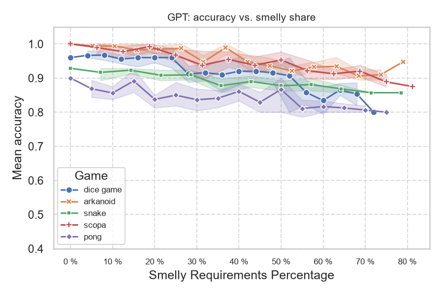
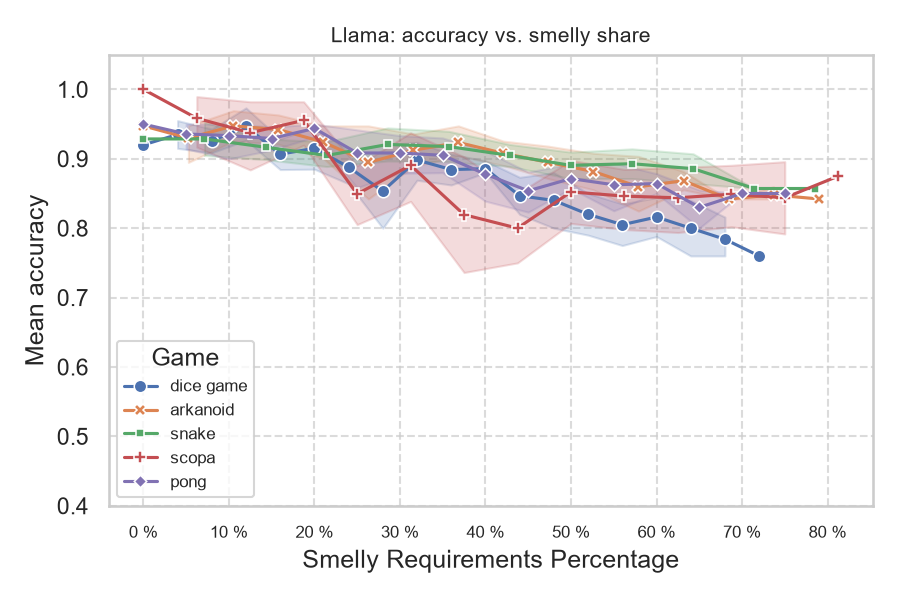

# Step A: Replication of the paper's analysis from the authors' saved runs

Input: `artifact/results_all.json` (114680 requirement-run rows, 1220 model x game x configuration groups). Majority vote over 5 runs per configuration, as in the authors' notebook. The pipeline is in `src/smellrep/metrics.py`.

## RQ1: tracing performance without smells

Columns prefixed `nb_` are the values printed in the authors' notebook.

| model             | game      |   accuracy |   nb_accuracy |   precision |   nb_precision |   recall |   nb_recall |    f1 |   nb_f1 |   max_abs_diff |
|:------------------|:----------|-----------:|--------------:|------------:|---------------:|---------:|------------:|------:|--------:|---------------:|
| gpt-4o-2024-08-06 | dice_game |      0.960 |         0.960 |       0.712 |          0.712 |    0.834 |       0.834 | 0.731 |   0.731 |          0.000 |
| gpt-4o-2024-08-06 | arkanoid  |      1.000 |         1.000 |       0.683 |          0.683 |    0.797 |       0.797 | 0.688 |   0.688 |          0.000 |
| gpt-4o-2024-08-06 | snake     |      0.929 |         0.929 |       0.610 |          0.610 |    0.749 |       0.749 | 0.629 |   0.629 |          0.000 |
| gpt-4o-2024-08-06 | scopa     |      1.000 |         1.000 |       0.738 |          0.738 |    0.836 |       0.836 | 0.741 |   0.741 |          0.000 |
| gpt-4o-2024-08-06 | pong      |      0.900 |         0.900 |       0.585 |          0.585 |    0.730 |       0.730 | 0.592 |   0.592 |          0.000 |
| llama3.1:70b      | dice_game |      0.920 |         0.920 |       0.683 |          0.683 |    0.727 |       0.727 | 0.655 |   0.655 |          0.000 |
| llama3.1:70b      | arkanoid  |      0.947 |         0.947 |       0.645 |          0.645 |    0.609 |       0.609 | 0.532 |   0.532 |          0.000 |
| llama3.1:70b      | snake     |      0.929 |         0.929 |       0.489 |          0.489 |    0.674 |       0.674 | 0.528 |   0.528 |          0.000 |
| llama3.1:70b      | scopa     |      1.000 |         1.000 |       0.642 |          0.642 |    0.695 |       0.695 | 0.629 |   0.629 |          0.000 |
| llama3.1:70b      | pong      |      0.950 |         0.950 |       0.654 |          0.654 |    0.709 |       0.709 | 0.643 |   0.643 |          0.000 |
| gpt-4o-2024-08-06 | MEAN      |      0.958 |         0.958 |       0.666 |          0.666 |    0.789 |       0.789 | 0.676 |   0.676 |          0.000 |
| llama3.1:70b      | MEAN      |      0.949 |         0.949 |       0.623 |          0.623 |    0.683 |       0.683 | 0.597 |   0.597 |          0.000 |

**Match with notebook (|diff| < 0.001): True** (largest difference 4.88e-07).

## RQ2: performance as the share of smelly requirements grows

Line plots (same layout as the paper's Fig. 2):

### Authors' mixed model, refitted

| outcome   |   intercept |   slope_per_pct |        z |         p | converged   |   LR_vs_OLS |
|:----------|------------:|----------------:|---------:|----------:|:------------|------------:|
| accuracy  |      0.9527 |      -0.00144   | -7.004   | 2.487e-12 | True        |       466.8 |
| precision |      0.6547 |      -0.0002717 | -0.03822 | 0.9695    | False       |      2231   |
| recall    |      0.7529 |      -0.0006564 | -1.54    | 0.1234    | True        |      1635   |
| f1        |      0.6484 |      -0.0005132 | -1.843   | 0.06534   | True        |      2068   |

Notebook reported for accuracy: intercept 0.953, slope -0.001, z = -7.001. Refit: intercept 0.953, slope -0.00144, z = -7.004. A slope of about -0.001 per percentage point means roughly -0.08 accuracy going from 0 % to 80 % smelly requirements.

## RQ3: performance per smell category

| model             | category   |   nb_accuracy |   accuracy_as_notebook |   accuracy_only_when_smelly |   accuracy_same_reqs_when_clean |   f1_as_notebook |   f1_only_when_smelly |   f1_same_reqs_when_clean |   n_smelly |   n_clean |
|:------------------|:-----------|--------------:|-----------------------:|----------------------------:|--------------------------------:|-----------------:|----------------------:|--------------------------:|-----------:|----------:|
| gpt-4o-2024-08-06 | lexical    |         0.897 |                  0.897 |                       0.854 |                           0.942 |            0.685 |                 0.686 |                     0.685 |       1502 |      1426 |
| gpt-4o-2024-08-06 | syntactic  |         0.977 |                  0.977 |                       0.954 |                           0.999 |            0.731 |                 0.713 |                     0.748 |       1207 |      1233 |
| gpt-4o-2024-08-06 | semantic   |         0.833 |                  0.833 |                       0.716 |                           0.954 |            0.628 |                 0.561 |                     0.686 |       1734 |      1682 |
| llama3.1:70b      | lexical    |         0.829 |                  0.829 |                       0.785 |                           0.872 |            0.635 |                 0.657 |                     0.615 |       1430 |      1498 |
| llama3.1:70b      | syntactic  |         0.910 |                  0.910 |                       0.857 |                           0.964 |            0.686 |                 0.675 |                     0.696 |       1234 |      1206 |
| llama3.1:70b      | semantic   |         0.862 |                  0.862 |                       0.763 |                           0.957 |            0.608 |                 0.571 |                     0.639 |       1681 |      1735 |

**Issue found in the original notebook.** The RQ3 cell filters rows by `smell_category` but not by `smelly == True`, so each category's score mixes configurations where the requirement was presented in its smelly form with configurations where the same requirement was presented in its clean form. `accuracy_as_notebook` reproduces the published value; `accuracy_only_when_smelly` is what the paper describes. Separately, the LaTeX export cell prints GPT-4o's F1 in the Llama F1 column.
