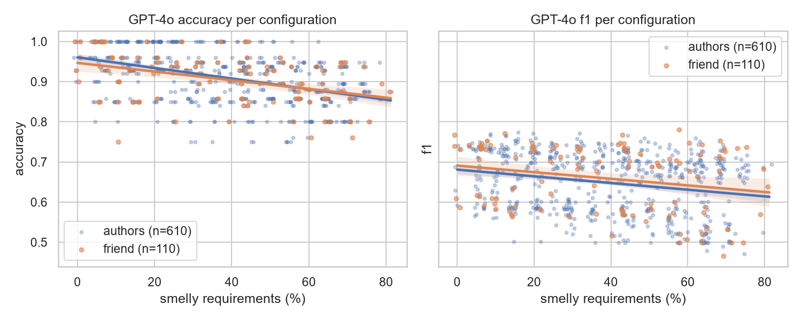

# Step B: friend's 550 GPT-4o runs vs. the authors' original runs

## 1. Are the friend's inputs identical to the Figshare artifact?

19 of 19 files byte-identical (code, requirements, prompts, ground truth, and the authors' results file).

## 2. Does our pipeline reproduce the numbers printed in the friend's notebook?

| game      |   ours_acc |   ours_p |   ours_r |   ours_f1 |   max_abs_diff |
|:----------|-----------:|---------:|---------:|----------:|---------------:|
| arkanoid  |      1.000 |    0.749 |    0.800 |     0.732 |          0.000 |
| dice_game |      0.960 |    0.726 |    0.906 |     0.767 |          0.000 |
| pong      |      0.900 |    0.550 |    0.830 |     0.610 |          0.000 |
| scopa     |      1.000 |    0.706 |    0.842 |     0.739 |          0.000 |
| snake     |      0.929 |    0.557 |    0.749 |     0.587 |          0.000 |

RQ3 category accuracy (notebook definition): semantic ours 0.8295 / notebook 0.8295, syntactic ours 0.9773 / notebook 0.9773, lexical ours 0.8902 / notebook 0.8902

## 3. No-smell and all-smell baselines: authors vs. friend (GPT-4o, majority of 5 runs)

| config        | game      |   authors_accuracy |   friend_accuracy |   authors_precision |   friend_precision |   authors_recall |   friend_recall |   authors_f1 |   friend_f1 |
|:--------------|:----------|-------------------:|------------------:|--------------------:|-------------------:|-----------------:|----------------:|-------------:|------------:|
| no_smells_01  | dice_game |              0.960 |             0.960 |               0.712 |              0.726 |            0.834 |           0.906 |        0.731 |       0.767 |
| no_smells_01  | arkanoid  |              1.000 |             1.000 |               0.683 |              0.749 |            0.797 |           0.800 |        0.688 |       0.732 |
| no_smells_01  | snake     |              0.929 |             0.929 |               0.610 |              0.557 |            0.749 |           0.749 |        0.629 |       0.587 |
| no_smells_01  | scopa     |              1.000 |             1.000 |               0.738 |              0.706 |            0.836 |           0.842 |        0.741 |       0.739 |
| no_smells_01  | pong      |              0.900 |             0.900 |               0.585 |              0.550 |            0.730 |           0.830 |        0.592 |       0.610 |
| all_smells_01 | dice_game |              0.800 |             0.760 |               0.690 |              0.753 |            0.821 |           0.863 |        0.710 |       0.734 |
| all_smells_01 | arkanoid  |              0.947 |             0.895 |               0.700 |              0.658 |            0.757 |           0.803 |        0.686 |       0.682 |
| all_smells_01 | snake     |              0.857 |             0.857 |               0.522 |              0.513 |            0.624 |           0.776 |        0.524 |       0.569 |
| all_smells_01 | scopa     |              0.875 |             0.875 |               0.744 |              0.675 |            0.765 |           0.714 |        0.694 |       0.638 |
| all_smells_01 | pong      |              0.800 |             0.800 |               0.557 |              0.563 |            0.591 |           0.610 |        0.472 |       0.499 |
| all_smells_01 | MEAN      |              0.856 |             0.837 |               0.643 |              0.632 |            0.712 |           0.753 |        0.617 |       0.625 |
| no_smells_01  | MEAN      |              0.958 |             0.958 |               0.666 |              0.658 |            0.789 |           0.825 |        0.676 |       0.687 |

## 4. Agreement on identical prompts

20 configurations have exactly the same smelly set in both datasets (the 10 baselines plus 10 random configurations that happen to coincide), giving 363 requirement-level comparisons.

- Same implemented yes/no decision: **99.2%** (Cohen's kappa 0.98)
- Mean Jaccard overlap of the majority-vote traced lines: **0.89** (median 1.00)

## 5. Stability of the five repeats (temperature 0)

Share of (configuration, requirement) pairs where all five runs gave the same answer:

| dataset        |   unanimous_implemented |   identical_lines_all_runs |
|:---------------|------------------------:|---------------------------:|
| authors GPT-4o |                   0.978 |                      0.671 |
| friend GPT-4o  |                   0.981 |                      0.702 |

## 6. Same trend? Accuracy vs. share of smelly requirements

OLS with game fixed effects and HC3 robust standard errors; slope = change in the outcome per 10 percentage points more smelly requirements.

| dataset                       | outcome   |   n_configs |   slope_per_10pct |   ci_low |   ci_high |      p |
|:------------------------------|:----------|------------:|------------------:|---------:|----------:|-------:|
| authors                       | accuracy  |         610 |           -0.0133 |  -0.0146 |   -0.0121 | 0.0000 |
| authors                       | f1        |         610 |           -0.0072 |  -0.0082 |   -0.0061 | 0.0000 |
| friend                        | accuracy  |         110 |           -0.0125 |  -0.0156 |   -0.0095 | 0.0000 |
| friend                        | f1        |         110 |           -0.0070 |  -0.0096 |   -0.0044 | 0.0000 |
| difference (friend - authors) | accuracy  |         720 |            0.0010 |  -0.0020 |    0.0040 | 0.5239 |
| difference (friend - authors) | f1        |         720 |            0.0004 |  -0.0024 |    0.0032 | 0.7739 |

