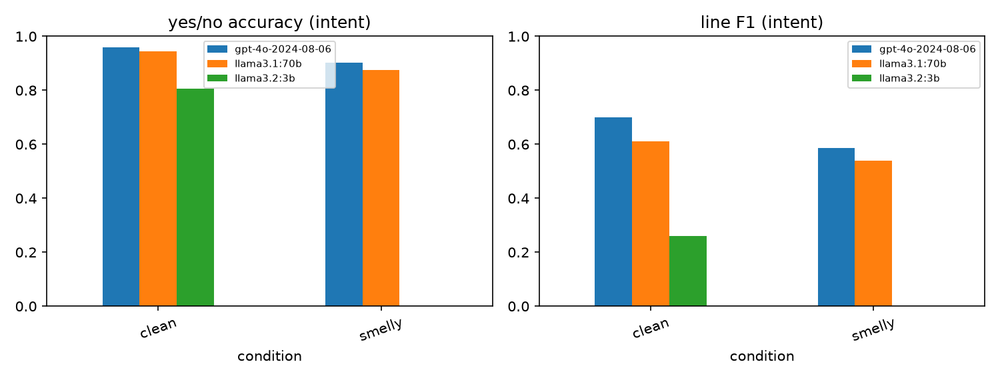

# Step C + smell fixer: fresh tracing runs with llama3.2:3b (free, local)

2 tracing runs on CPU (7 min total, temperature 0, so one run per condition is deterministic). Runs with parse problems or missing requirements: 0. The prompt is byte-for-byte the authors' prompt. Rows for GPT-4o and Llama-3.1-70B come from the authors' saved no-smell / all-smell runs, for reference.

*smellable* = the 72 requirements that have a smelly variant. `acc_smellable_intent` and `f1_smellable_intent` score against the clean requirement's ground truth, i.e. whether the original intent was still traced correctly.

| model             | condition   |   acc_all |   acc_smellable_label |   acc_smellable_intent |   f1_smellable_intent |   said_yes |   n_smellable |
|:------------------|:------------|----------:|----------------------:|-----------------------:|----------------------:|-----------:|--------------:|
| gpt-4o-2024-08-06 | clean       |     0.957 |                 0.958 |                  0.958 |                 0.699 |      0.745 |            72 |
| gpt-4o-2024-08-06 | smelly      |     0.851 |                 0.819 |                  0.903 |                 0.585 |      0.702 |            72 |
| llama3.1:70b      | clean       |     0.947 |                 0.944 |                  0.944 |                 0.611 |      0.713 |            72 |
| llama3.1:70b      | smelly      |     0.830 |                 0.792 |                  0.875 |                 0.539 |      0.681 |            72 |
| llama3.2:3b       | clean       |     0.829 |                 0.806 |                  0.806 |                 0.261 |      0.951 |            31 |

## Did the fixer recover the loss? (local model, smellable requirements)

95% CIs from a bootstrap over requirements. `share_of_gap_recovered` = (fixed - smelly) / (clean - smelly); it is unstable when the clean-smelly gap is tiny.

## Fixer text quality (smelly requirements only)

`sim_*` = content-word overlap (Jaccard, stop words removed) with the authors' clean version. `drifted` = the rewrite overlaps clearly more with a *different* requirement's clean text (the fixer mixed requirements up). Rule flags come from the rule-based detector.

| mode    |   n |   changed |   sim_input_to_clean |   sim_fixed_to_clean |   drifted |   rule_flags_before |   rule_flags_after |   own_smell_flag_removed |
|:--------|----:|----------:|---------------------:|---------------------:|----------:|--------------------:|-------------------:|-------------------------:|
| blind   |  44 |     0.045 |                0.672 |                0.669 |     0.023 |               1.068 |              1.068 |                    0.000 |
| oracle  |  57 |     0.246 |                0.675 |                0.670 |     0.035 |               1.211 |              1.123 |                    0.088 |
| rewrite |  72 |     0.972 |                0.660 |                0.472 |     0.097 |               1.222 |              0.639 |                    0.333 |

| mode    | smell_category   |   changed |   sim_gain |
|:--------|:-----------------|----------:|-----------:|
| blind   | lexical          |     0.000 |      0.686 |
| blind   | semantic         |     0.000 |      0.686 |
| blind   | syntactic        |     0.154 |      0.628 |
| oracle  | lexical          |     0.316 |      0.702 |
| oracle  | semantic         |     0.182 |      0.669 |
| oracle  | syntactic        |     0.250 |      0.633 |
| rewrite | lexical          |     1.000 |      0.478 |
| rewrite | semantic         |     0.964 |      0.463 |
| rewrite | syntactic        |     0.950 |      0.477 |

## Per smell category (local model, smellable requirements)

| smell_category   | condition   |   acc_intent |   f1_intent |   n |
|:-----------------|:------------|-------------:|------------:|----:|
| lexical          | clean       |        0.727 |       0.265 |  11 |
| semantic         | clean       |        0.818 |       0.226 |  11 |
| syntactic        | clean       |        0.889 |       0.297 |   9 |

