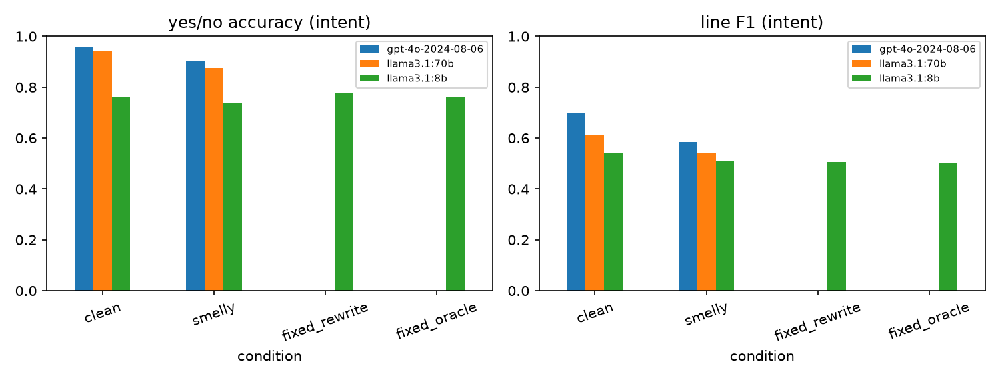

# Step C + smell fixer: fresh tracing runs with llama3.1:8b (free, local)

20 tracing runs on CPU (510 min total, temperature 0, so one run per condition is deterministic). Runs with parse problems or missing requirements: 0. The prompt is byte-for-byte the authors' prompt. Rows for GPT-4o and Llama-3.1-70B come from the authors' saved no-smell / all-smell runs, for reference.

*smellable* = the 72 requirements that have a smelly variant. `acc_smellable_intent` and `f1_smellable_intent` score against the clean requirement's ground truth, i.e. whether the original intent was still traced correctly.

| model             | condition     |   acc_all |   acc_smellable_label |   acc_smellable_intent |   f1_smellable_intent |   said_yes |   n_smellable |
|:------------------|:--------------|----------:|----------------------:|-----------------------:|----------------------:|-----------:|--------------:|
| gpt-4o-2024-08-06 | clean         |     0.957 |                 0.958 |                  0.958 |                 0.699 |      0.745 |            72 |
| gpt-4o-2024-08-06 | smelly        |     0.851 |                 0.819 |                  0.903 |                 0.585 |      0.702 |            72 |
| llama3.1:70b      | clean         |     0.947 |                 0.944 |                  0.944 |                 0.611 |      0.713 |            72 |
| llama3.1:70b      | smelly        |     0.830 |                 0.792 |                  0.875 |                 0.539 |      0.681 |            72 |
| llama3.1:8b       | clean         |     0.819 |                 0.764 |                  0.764 |                 0.540 |      0.904 |            72 |
| llama3.1:8b       | smelly        |     0.681 |                 0.597 |                  0.736 |                 0.508 |      0.872 |            72 |
| llama3.1:8b       | fixed_rewrite |     0.702 |                 0.639 |                  0.778 |                 0.507 |      0.894 |            72 |
| llama3.1:8b       | fixed_oracle  |     0.713 |                 0.625 |                  0.764 |                 0.504 |      0.904 |            72 |

## Did the fixer recover the loss? (local model, smellable requirements)

95% CIs from a bootstrap over requirements. `share_of_gap_recovered` = (fixed - smelly) / (clean - smelly); it is unstable when the clean-smelly gap is tiny.

| metric         | fixer         |   clean |   smelly |   fixed |   fixed_minus_smelly |   ci_low |   ci_high |   share_of_gap_recovered |
|:---------------|:--------------|--------:|---------:|--------:|---------------------:|---------:|----------:|-------------------------:|
| correct_intent | fixed_rewrite |   0.764 |    0.736 |   0.778 |                0.042 |   -0.028 |     0.111 |                    1.500 |
| correct_intent | fixed_oracle  |   0.764 |    0.736 |   0.764 |                0.028 |   -0.042 |     0.097 |                    1.000 |
| f1_intent      | fixed_rewrite |   0.540 |    0.508 |   0.507 |               -0.001 |   -0.052 |     0.057 |                   -0.042 |
| f1_intent      | fixed_oracle  |   0.540 |    0.508 |   0.504 |               -0.004 |   -0.075 |     0.066 |                   -0.118 |
| correct        | fixed_rewrite |   0.764 |    0.597 |   0.639 |                0.042 |   -0.028 |     0.111 |                    0.250 |
| correct        | fixed_oracle  |   0.764 |    0.597 |   0.625 |                0.028 |   -0.042 |     0.097 |                    0.167 |

## Fixer text quality (smelly requirements only)

`sim_*` = content-word overlap (Jaccard, stop words removed) with the authors' clean version. `drifted` = the rewrite overlaps clearly more with a *different* requirement's clean text (the fixer mixed requirements up). Rule flags come from the rule-based detector.

| mode    |   n |   changed |   sim_input_to_clean |   sim_fixed_to_clean |   drifted |   rule_flags_before |   rule_flags_after |   own_smell_flag_removed |
|:--------|----:|----------:|---------------------:|---------------------:|----------:|--------------------:|-------------------:|-------------------------:|
| blind   |  72 |     0.681 |                0.660 |                0.632 |     0.028 |               1.222 |              0.889 |                    0.194 |
| oracle  |  72 |     0.694 |                0.660 |                0.664 |     0.028 |               1.222 |              1.000 |                    0.236 |
| rewrite |  72 |     0.972 |                0.660 |                0.540 |     0.028 |               1.222 |              0.750 |                    0.264 |

| mode    | smell_category   |   changed |   sim_gain |
|:--------|:-----------------|----------:|-----------:|
| blind   | lexical          |     0.833 |      0.601 |
| blind   | semantic         |     0.607 |      0.635 |
| blind   | syntactic        |     0.600 |      0.666 |
| oracle  | lexical          |     0.792 |      0.674 |
| oracle  | semantic         |     0.607 |      0.639 |
| oracle  | syntactic        |     0.700 |      0.686 |
| rewrite | lexical          |     1.000 |      0.501 |
| rewrite | semantic         |     0.964 |      0.542 |
| rewrite | syntactic        |     0.950 |      0.582 |

## Per smell category (local model, smellable requirements)

| smell_category   | condition     |   acc_intent |   f1_intent |   n |
|:-----------------|:--------------|-------------:|------------:|----:|
| lexical          | clean         |        0.750 |       0.543 |  24 |
| lexical          | fixed_oracle  |        0.792 |       0.501 |  24 |
| lexical          | fixed_rewrite |        0.750 |       0.478 |  24 |
| lexical          | smelly        |        0.625 |       0.367 |  24 |
| semantic         | clean         |        0.679 |       0.510 |  28 |
| semantic         | fixed_oracle  |        0.714 |       0.493 |  28 |
| semantic         | fixed_rewrite |        0.679 |       0.508 |  28 |
| semantic         | smelly        |        0.714 |       0.558 |  28 |
| syntactic        | clean         |        0.900 |       0.567 |  20 |
| syntactic        | fixed_oracle  |        0.800 |       0.519 |  20 |
| syntactic        | fixed_rewrite |        0.950 |       0.529 |  20 |
| syntactic        | smelly        |        0.900 |       0.574 |  20 |

