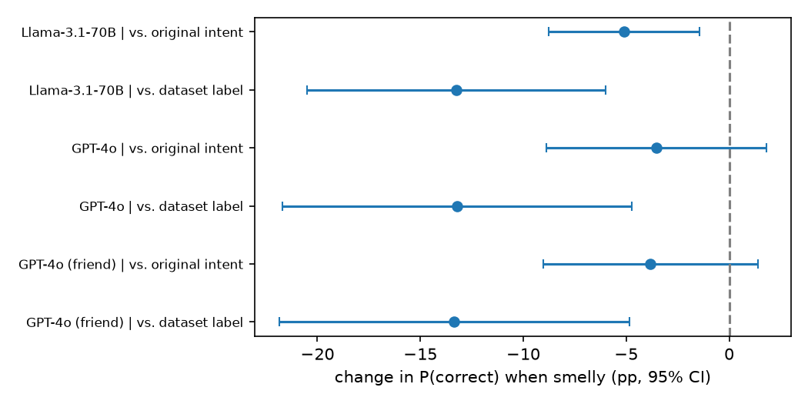

# Improved statistics: is the smell effect real, and how large is it?

## 0. Context: how hard is the yes/no decision?

`always_yes_accuracy` is the accuracy of a dummy that answers *implemented* for every requirement. The binary task is lopsided, so small accuracy changes matter.

| model           |   model_accuracy |   always_yes_accuracy |   share_smelly |
|:----------------|-----------------:|----------------------:|---------------:|
| GPT-4o (friend) |            0.905 |                 0.691 |          0.372 |
| GPT-4o          |            0.908 |                 0.691 |          0.387 |
| Llama-3.1-70B   |            0.885 |                 0.693 |          0.379 |

## 1. Within-requirement effect of a smell on the yes/no decision

**M1** linear probability model with one fixed effect per requirement, so `smelly` is estimated only from the same requirement appearing smelly in some configurations and clean in others. Estimates are percentage-point changes in the probability of a correct decision; `pct_other_smelly` is per 1 point of the *other* requirements being smelly (spill-over). *vs. dataset label* uses the authors' scoring (for smelly requirements the correct answer is `smelly_traceable`); *vs. original intent* scores against whether the clean requirement is implemented.

| model           | outcome             | term             |   estimate |   ci_low |   ci_high |      p |     n |   clusters |
|:----------------|:--------------------|:-----------------|-----------:|---------:|----------:|-------:|------:|-----------:|
| GPT-4o (friend) | vs. dataset label   | smelly           |    -0.1335 |  -0.2186 |   -0.0485 | 0.0021 |  2068 |         94 |
| GPT-4o (friend) | vs. dataset label   | pct_other_smelly |     0.0000 |  -0.0005 |    0.0005 | 0.9967 |  2068 |         94 |
| GPT-4o (friend) | vs. original intent | smelly           |    -0.0381 |  -0.0903 |    0.0140 | 0.1517 |  2068 |         94 |
| GPT-4o (friend) | vs. original intent | pct_other_smelly |     0.0000 |  -0.0004 |    0.0004 | 0.9964 |  2068 |         94 |
| GPT-4o          | vs. dataset label   | smelly           |    -0.1321 |  -0.2171 |   -0.0471 | 0.0023 | 11468 |         94 |
| GPT-4o          | vs. dataset label   | pct_other_smelly |    -0.0001 |  -0.0003 |    0.0002 | 0.5787 | 11468 |         94 |
| GPT-4o          | vs. original intent | smelly           |    -0.0354 |  -0.0888 |    0.0181 | 0.1944 | 11468 |         94 |
| GPT-4o          | vs. original intent | pct_other_smelly |    -0.0000 |  -0.0003 |    0.0002 | 0.7388 | 11468 |         94 |
| Llama-3.1-70B   | vs. dataset label   | smelly           |    -0.1325 |  -0.2049 |   -0.0601 | 0.0003 | 11468 |         94 |
| Llama-3.1-70B   | vs. dataset label   | pct_other_smelly |    -0.0004 |  -0.0009 |    0.0002 | 0.1710 | 11468 |         94 |
| Llama-3.1-70B   | vs. original intent | smelly           |    -0.0511 |  -0.0877 |   -0.0146 | 0.0061 | 11468 |         94 |
| Llama-3.1-70B   | vs. original intent | pct_other_smelly |    -0.0003 |  -0.0008 |    0.0002 | 0.2303 | 11468 |         94 |

**M2/M3** odds ratios for a correct decision. `pct_other_smelly_10` is per 10 points of the other requirements being smelly. M3 compares each requirement only with itself and uses only requirements whose correctness varies; its standard errors treat the configurations of one requirement as independent, so its p-values are optimistic. M1 (clustered) is the primary test.

| model           | outcome             | method                 | term                |   odds_ratio |   or_ci_low |   or_ci_high |     p |   informative_reqs |
|:----------------|:--------------------|:-----------------------|:--------------------|-------------:|------------:|-------------:|------:|-------------------:|
| GPT-4o (friend) | vs. dataset label   | M2 logit, clustered SE | smelly              |        0.181 |       0.061 |        0.535 | 0.002 |            nan     |
| GPT-4o (friend) | vs. dataset label   | M2 logit, clustered SE | pct_other_smelly_10 |        1.019 |       0.931 |        1.115 | 0.685 |            nan     |
| GPT-4o (friend) | vs. dataset label   | M3 conditional logit   | smelly              |        0.035 |       0.016 |        0.076 | 0.000 |             18.000 |
| GPT-4o (friend) | vs. dataset label   | M3 conditional logit   | pct_other_smelly_10 |        1.083 |       0.929 |        1.262 | 0.308 |             18.000 |
| GPT-4o (friend) | vs. original intent | M2 logit, clustered SE | smelly              |        0.494 |       0.163 |        1.498 | 0.213 |            nan     |
| GPT-4o (friend) | vs. original intent | M2 logit, clustered SE | pct_other_smelly_10 |        1.003 |       0.882 |        1.140 | 0.969 |            nan     |
| GPT-4o (friend) | vs. original intent | M3 conditional logit   | smelly              |        0.206 |       0.089 |        0.474 | 0.000 |             12.000 |
| GPT-4o (friend) | vs. original intent | M3 conditional logit   | pct_other_smelly_10 |        1.051 |       0.889 |        1.243 | 0.558 |             12.000 |
| GPT-4o          | vs. dataset label   | M2 logit, clustered SE | smelly              |        0.197 |       0.063 |        0.614 | 0.005 |            nan     |
| GPT-4o          | vs. dataset label   | M2 logit, clustered SE | pct_other_smelly_10 |        0.984 |       0.916 |        1.058 | 0.671 |            nan     |
| GPT-4o          | vs. dataset label   | M3 conditional logit   | smelly              |        0.026 |       0.019 |        0.036 | 0.000 |             21.000 |
| GPT-4o          | vs. dataset label   | M3 conditional logit   | pct_other_smelly_10 |        1.013 |       0.943 |        1.088 | 0.725 |             21.000 |
| GPT-4o          | vs. original intent | M2 logit, clustered SE | smelly              |        0.511 |       0.155 |        1.689 | 0.271 |            nan     |
| GPT-4o          | vs. original intent | M2 logit, clustered SE | pct_other_smelly_10 |        0.988 |       0.889 |        1.099 | 0.826 |            nan     |
| GPT-4o          | vs. original intent | M3 conditional logit   | smelly              |        0.205 |       0.145 |        0.290 | 0.000 |             14.000 |
| GPT-4o          | vs. original intent | M3 conditional logit   | pct_other_smelly_10 |        0.994 |       0.918 |        1.077 | 0.891 |             14.000 |
| Llama-3.1-70B   | vs. dataset label   | M2 logit, clustered SE | smelly              |        0.263 |       0.120 |        0.579 | 0.001 |            nan     |
| Llama-3.1-70B   | vs. dataset label   | M2 logit, clustered SE | pct_other_smelly_10 |        0.969 |       0.911 |        1.030 | 0.311 |            nan     |
| Llama-3.1-70B   | vs. dataset label   | M3 conditional logit   | smelly              |        0.085 |       0.067 |        0.108 | 0.000 |             35.000 |
| Llama-3.1-70B   | vs. dataset label   | M3 conditional logit   | pct_other_smelly_10 |        0.914 |       0.868 |        0.963 | 0.001 |             35.000 |
| Llama-3.1-70B   | vs. original intent | M2 logit, clustered SE | smelly              |        0.456 |       0.218 |        0.954 | 0.037 |            nan     |
| Llama-3.1-70B   | vs. original intent | M2 logit, clustered SE | pct_other_smelly_10 |        0.974 |       0.902 |        1.052 | 0.505 |            nan     |
| Llama-3.1-70B   | vs. original intent | M3 conditional logit   | smelly              |        0.293 |       0.230 |        0.375 | 0.000 |             29.000 |
| Llama-3.1-70B   | vs. original intent | M3 conditional logit   | pct_other_smelly_10 |        0.899 |       0.848 |        0.952 | 0.000 |             29.000 |

## 2. Where does the drop come from? Smells that change the correct answer

In 10 requirements the smelly rewrite makes the requirement *untraceable* (e.g., a contradiction), so the authors' ground truth flips from yes to no. `said_implemented` is how often the model still answered yes.

| model           | label_flipped   |    n |   accuracy |   said_implemented |
|:----------------|:----------------|-----:|-----------:|-------------------:|
| GPT-4o (friend) | False           |  659 |      0.933 |              0.589 |
| GPT-4o (friend) | True            |  111 |      0.144 |              0.856 |
| GPT-4o          | False           | 3833 |      0.935 |              0.593 |
| GPT-4o          | True            |  610 |      0.149 |              0.851 |
| Llama-3.1-70B   | False           | 3755 |      0.887 |              0.564 |
| Llama-3.1-70B   | True            |  590 |      0.227 |              0.773 |

M1 re-estimated without the label-flipping requirements:

| model           | subset                                 | term             |   estimate |   ci_low |   ci_high |      p |     n |   clusters |
|:----------------|:---------------------------------------|:-----------------|-----------:|---------:|----------:|-------:|------:|-----------:|
| GPT-4o (friend) | requirements whose label does not flip | smelly           |    -0.0207 |  -0.0739 |    0.0324 | 0.4448 |  1848 |         84 |
| GPT-4o (friend) | requirements whose label does not flip | pct_other_smelly |     0.0001 |  -0.0003 |    0.0005 | 0.6514 |  1848 |         84 |
| GPT-4o          | requirements whose label does not flip | smelly           |    -0.0180 |  -0.0713 |    0.0354 | 0.5097 | 10248 |         84 |
| GPT-4o          | requirements whose label does not flip | pct_other_smelly |    -0.0000 |  -0.0003 |    0.0003 | 0.9683 | 10248 |         84 |
| Llama-3.1-70B   | requirements whose label does not flip | smelly           |    -0.0361 |  -0.0693 |   -0.0030 | 0.0326 | 10248 |         84 |
| Llama-3.1-70B   | requirements whose label does not flip | pct_other_smelly |    -0.0003 |  -0.0008 |    0.0002 | 0.2529 | 10248 |         84 |

## 3. Effect on the traced lines (F1)

Same M1 design with line-level F1 as outcome (F1 points, 0-1 scale).

| model           | outcome                               | term             |   estimate |   ci_low |   ci_high |      p |    n |   clusters |
|:----------------|:--------------------------------------|:-----------------|-----------:|---------:|----------:|-------:|-----:|-----------:|
| GPT-4o (friend) | notebook F1 (drops empty predictions) | smelly           |    -0.0517 |  -0.0980 |   -0.0055 | 0.0285 | 1494 |         70 |
| GPT-4o (friend) | notebook F1 (drops empty predictions) | pct_other_smelly |    -0.0002 |  -0.0005 |    0.0001 | 0.2124 | 1494 |         70 |
| GPT-4o (friend) | strict F1 (empty prediction = 0)      | smelly           |    -0.0534 |  -0.1139 |    0.0071 | 0.0839 | 1429 |         70 |
| GPT-4o (friend) | strict F1 (empty prediction = 0)      | pct_other_smelly |    -0.0001 |  -0.0004 |    0.0003 | 0.6376 | 1429 |         70 |
| GPT-4o          | notebook F1 (drops empty predictions) | smelly           |    -0.0448 |  -0.0938 |    0.0042 | 0.0733 | 8274 |         70 |
| GPT-4o          | notebook F1 (drops empty predictions) | pct_other_smelly |    -0.0002 |  -0.0004 |   -0.0001 | 0.0058 | 8274 |         70 |
| GPT-4o          | strict F1 (empty prediction = 0)      | smelly           |    -0.0416 |  -0.0997 |    0.0165 | 0.1601 | 7930 |         70 |
| GPT-4o          | strict F1 (empty prediction = 0)      | pct_other_smelly |    -0.0002 |  -0.0004 |   -0.0000 | 0.0467 | 7930 |         70 |
| Llama-3.1-70B   | notebook F1 (drops empty predictions) | smelly           |    -0.0281 |  -0.0756 |    0.0193 | 0.2446 | 7751 |         69 |
| Llama-3.1-70B   | notebook F1 (drops empty predictions) | pct_other_smelly |     0.0000 |  -0.0004 |    0.0004 | 0.9639 | 7751 |         69 |
| Llama-3.1-70B   | strict F1 (empty prediction = 0)      | smelly           |    -0.0329 |  -0.0791 |    0.0132 | 0.1621 | 7950 |         70 |
| Llama-3.1-70B   | strict F1 (empty prediction = 0)      | pct_other_smelly |    -0.0001 |  -0.0006 |    0.0004 | 0.7309 | 7950 |         70 |

## 4. The paper's configuration-level question with a bounded model

**M4** binomial GLM of correct decisions per configuration with game fixed effects. Odds ratio per 10 points more smelly requirements. The dispersion is far below 1 because the same requirements recur in every configuration, so the binomial SEs are kept rather than shrunk; M1-M3 are the more trustworthy tests.

| model           |   OR_per_10pct |   ci_low |   ci_high |      p |   pearson_chi2_per_df |
|:----------------|---------------:|---------:|----------:|-------:|----------------------:|
| GPT-4o (friend) |         0.8527 |   0.7979 |    0.9113 | 0.0000 |                0.4286 |
| GPT-4o          |         0.8357 |   0.8088 |    0.8635 | 0.0000 |                0.4269 |
| Llama-3.1-70B   |         0.8461 |   0.8213 |    0.8717 | 0.0000 |                0.5259 |

