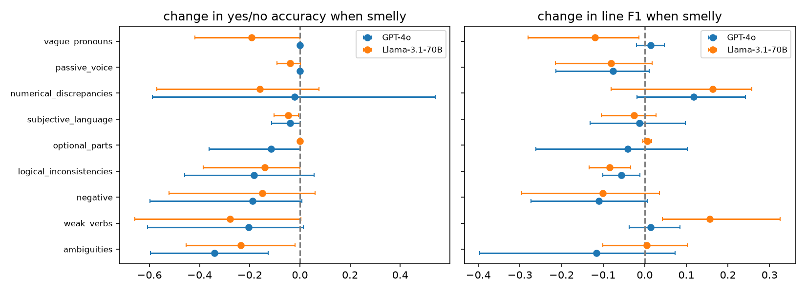
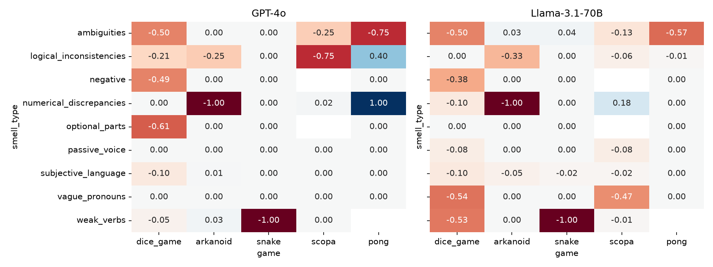

# Breakdown by smell type, game, and requirement

Delta = (score when the requirement is smelly) - (score of the same requirement when clean), averaged over the random configurations. Accuracy is the implemented yes/no decision scored like the paper; *intent* scores against the clean requirement's ground truth; F1 is line-level F1 with empty predictions counted as 0. 95% CIs bootstrap whole requirements. Requirements whose smelly version flips the ground truth to *not traceable* (10) are marked with *.

## 1. By smell type

| model         | smell_type              | category   |   n_reqs |   n_label_flips |   delta_acc |   acc_lo |   acc_hi |   delta_acc_intent |   acc_intent_lo |   acc_intent_hi |   delta_f1 |   f1_lo |   f1_hi |
|:--------------|:------------------------|:-----------|---------:|----------------:|------------:|---------:|---------:|-------------------:|----------------:|----------------:|-----------:|--------:|--------:|
| GPT-4o        | ambiguities             | semantic   |       15 |               4 |      -0.340 |   -0.595 |   -0.127 |             -0.065 |          -0.202 |           0.003 |     -0.116 |  -0.397 |   0.073 |
| GPT-4o        | weak_verbs              | lexical    |        5 |               1 |      -0.205 |   -0.607 |    0.013 |             -0.003 |          -0.028 |           0.020 |      0.015 |  -0.037 |   0.085 |
| GPT-4o        | negative                | syntactic  |        5 |               1 |      -0.189 |   -0.598 |    0.009 |              0.003 |           0.000 |           0.009 |     -0.110 |  -0.273 |   0.006 |
| GPT-4o        | logical_inconsistencies | semantic   |        8 |               2 |      -0.182 |   -0.460 |    0.057 |             -0.066 |          -0.230 |           0.095 |     -0.056 |  -0.100 |  -0.012 |
| GPT-4o        | optional_parts          | lexical    |        5 |               0 |      -0.114 |   -0.362 |    0.000 |             -0.114 |          -0.362 |           0.000 |     -0.040 |  -0.261 |   0.102 |
| GPT-4o        | subjective_language     | lexical    |       14 |               0 |      -0.039 |   -0.113 |    0.002 |             -0.039 |          -0.113 |           0.002 |     -0.012 |  -0.131 |   0.098 |
| GPT-4o        | numerical_discrepancies | semantic   |        5 |               2 |      -0.021 |   -0.588 |    0.539 |             -0.030 |          -0.590 |           0.539 |      0.117 |  -0.019 |   0.242 |
| GPT-4o        | passive_voice           | syntactic  |       10 |               0 |       0.000 |    0.000 |    0.000 |              0.000 |           0.000 |           0.000 |     -0.076 |  -0.214 |   0.010 |
| GPT-4o        | vague_pronouns          | syntactic  |        5 |               0 |       0.000 |    0.000 |    0.000 |              0.000 |           0.000 |           0.000 |      0.014 |  -0.020 |   0.047 |
| Llama-3.1-70B | weak_verbs              | lexical    |        5 |               1 |      -0.278 |   -0.658 |    0.005 |             -0.118 |          -0.338 |           0.007 |      0.156 |   0.042 |   0.325 |
| Llama-3.1-70B | ambiguities             | semantic   |       15 |               4 |      -0.236 |   -0.454 |   -0.020 |             -0.010 |          -0.086 |           0.064 |      0.005 |  -0.100 |   0.102 |
| Llama-3.1-70B | vague_pronouns          | syntactic  |        5 |               0 |      -0.193 |   -0.418 |    0.000 |             -0.193 |          -0.418 |           0.000 |     -0.120 |  -0.281 |  -0.014 |
| Llama-3.1-70B | numerical_discrepancies | semantic   |        5 |               2 |      -0.160 |   -0.570 |    0.076 |             -0.184 |          -0.504 |           0.000 |      0.163 |  -0.081 |   0.257 |
| Llama-3.1-70B | negative                | syntactic  |        5 |               1 |      -0.149 |   -0.521 |    0.061 |              0.022 |           0.000 |           0.065 |     -0.100 |  -0.295 |   0.036 |
| Llama-3.1-70B | logical_inconsistencies | semantic   |        8 |               2 |      -0.140 |   -0.386 |    0.000 |             -0.088 |          -0.248 |           0.001 |     -0.084 |  -0.134 |  -0.034 |
| Llama-3.1-70B | subjective_language     | lexical    |       14 |               0 |      -0.046 |   -0.102 |   -0.006 |             -0.046 |          -0.102 |          -0.006 |     -0.026 |  -0.105 |   0.027 |
| Llama-3.1-70B | passive_voice           | syntactic  |       10 |               0 |      -0.039 |   -0.091 |    0.002 |             -0.039 |          -0.091 |           0.002 |     -0.081 |  -0.215 |   0.018 |
| Llama-3.1-70B | optional_parts          | lexical    |        5 |               0 |       0.000 |    0.000 |    0.000 |              0.000 |           0.000 |           0.000 |      0.006 |  -0.005 |   0.016 |

## 2. By category (corrected RQ3: only configurations where the requirement is smelly)

| model         | category   | subset              |   acc_smelly |   acc_clean |   f1_smelly |   f1_clean |   delta_acc |   delta_f1 |
|:--------------|:-----------|:--------------------|-------------:|------------:|------------:|-----------:|------------:|-----------:|
| GPT-4o        | lexical    | all                 |        0.854 |       0.942 |       0.661 |      0.665 |      -0.088 |     -0.004 |
| GPT-4o        | lexical    | without label flips |        0.892 |       0.939 |       0.661 |      0.674 |      -0.048 |     -0.013 |
| GPT-4o        | semantic   | all                 |        0.716 |       0.954 |       0.611 |      0.685 |      -0.238 |     -0.074 |
| GPT-4o        | semantic   | without label flips |        0.925 |       0.936 |       0.611 |      0.711 |      -0.011 |     -0.100 |
| GPT-4o        | syntactic  | all                 |        0.954 |       0.999 |       0.708 |      0.748 |      -0.046 |     -0.040 |
| GPT-4o        | syntactic  | without label flips |        1.000 |       0.999 |       0.708 |      0.745 |       0.001 |     -0.037 |
| Llama-3.1-70B | lexical    | all                 |        0.785 |       0.872 |       0.573 |      0.552 |      -0.087 |      0.021 |
| Llama-3.1-70B | lexical    | without label flips |        0.812 |       0.865 |       0.573 |      0.553 |      -0.053 |      0.021 |
| Llama-3.1-70B | semantic   | all                 |        0.763 |       0.957 |       0.635 |      0.615 |      -0.194 |      0.020 |
| Llama-3.1-70B | semantic   | without label flips |        0.960 |       0.960 |       0.635 |      0.636 |      -0.000 |     -0.001 |
| Llama-3.1-70B | syntactic  | all                 |        0.857 |       0.964 |       0.580 |      0.675 |      -0.106 |     -0.095 |
| Llama-3.1-70B | syntactic  | without label flips |        0.899 |       0.965 |       0.580 |      0.662 |      -0.066 |     -0.082 |

## 3. Smell type x game (change in accuracy, GPT-4o | Llama-3.1-70B)

## 4. Requirements that fail most when smelly

Mean over both models. `said_yes_smelly` = how often the model still answered *implemented* for the smelly version.

- **arkanoid#8*** (numerical_discrepancies) delta acc -1.00, delta F1 +nan, said yes 100%  
  clean: _A brick is sized single (20 x 10 pixels) or double (40 x 10 pixels)._  
  smelly: _A brick is sized single (20 x 10 pixels) or double (60 x 10 pixels)._

- **dice_game#24*** (ambiguities) delta acc -1.00, delta F1 +nan, said yes 100%  
  clean: _The player with the most points after the game has ended will be the winner._  
  smelly: _After the game has ended, one player shall be the winner._

- **pong#7*** (ambiguities) delta acc -1.00, delta F1 +nan, said yes 100%  
  clean: _The paddles are located on the left and right side of the board and can only move vertically in a straight line._  
  smelly: _The paddles are located on the left and right side of the board._

- **pong#6*** (ambiguities) delta acc -1.00, delta F1 +nan, said yes 100%  
  clean: _The board is a rectangle consisting of 120 x 80 blocks with the longer side being on the horizontal axis. Each block has a size of 10 x 10 pixels._  
  smelly: _The blocks composing the rectangular board shall have a size of 10 x 10 pixels._

- **snake#8*** (weak_verbs) delta acc -1.00, delta F1 +nan, said yes 100%  
  clean: _When the user presses up, down, right, or left on the keyboard, the snake continues to move to the corresponding direction._  
  smelly: _The snake could be moved by pressing up, down, right, or left on the keyboard._

- **dice_game#13*** (negative) delta acc -0.93, delta F1 +nan, said yes 97%  
  clean: _If the current player throws a 6, the next player's turn is skipped._  
  smelly: _If the current player throws a 6, his turn must not continue._

- **arkanoid#14*** (logical_inconsistencies) delta acc -0.88, delta F1 +nan, said yes 88%  
  clean: _When the user finishes a level, the next level with a different brick arrangement and increased difficulty begins. Each level adds two red bricks and one gold brick._  
  smelly: _When the user finishes a level, the next level with a different brick arrangement and increased difficulty begins. Each level removes two red bricks and one gold brick._

- **scopa#15*** (ambiguities) delta acc -0.84, delta F1 +nan, said yes 87%  
  clean: _After the round has ended, all players tally up their points. If any player reaches the winning score, the game ends. If not, a new round begins._  
  smelly: _After the round has ended, all players tally up their points. If any player reaches the predetermined score, the game ends._

- **pong#10** (ambiguities) delta acc -0.64, delta F1 -0.55, said yes 36%  
  clean: _The goal is to score points by kicking the ball past the opponent's paddle. The first player to reach 10 points wins and the game ends._  
  smelly: _The goal is score points by kicking the ball to the goal. The first player to get many points wins and the game ends._

- **scopa#4*** (logical_inconsistencies) delta acc -0.41, delta F1 +nan, said yes 51%  
  clean: _The game is played with a deck of 40 cards, divided into four suits (Coins, Cups, Swords, and Clubs)._  
  smelly: _The game is played with a deck of 40 cards, divided into four suits (Coins, Cups, Swords, Hearts, and Clubs)._

- **dice_game#12** (subjective_language) delta acc -0.39, delta F1 -0.30, said yes 43%  
  clean: _If a player's points get above 11, his point color shall turn purple._  
  smelly: _If a player's points are sufficient to win, his point color shall turn purple._

- **dice_game#23** (optional_parts) delta acc -0.30, delta F1 -0.12, said yes 51%  
  clean: _After a game has ended, the system shall print the players' points and the winner._  
  smelly: _If needed, the system can print the players' points and the winner after a game has ended._

- **dice_game#20** (weak_verbs) delta acc -0.29, delta F1 +nan, said yes 29%  
  clean: _In each turn, the player must decide if he wants to skip his turn._  
  smelly: _In each turn, the player could skip his turn._

- **dice_game#15** (vague_pronouns) delta acc -0.27, delta F1 -0.21, said yes 73%  
  clean: _If the points turn equal at any point in the game, the game shall print: "Equality!"._  
  smelly: _The game shall check the players' points at any point in the game. If they turn equal, it shall print: "Equality!"._

- **scopa#10** (vague_pronouns) delta acc -0.23, delta F1 -0.06, said yes 57%  
  clean: _If the value of the selected card during a player's turn matches the value of one card on the table, the player puts the matching card on his discard pile._  
  smelly: _If the value of the selected card during a player's turn matches the value of one card on the table, the player puts it on his discard pile._

## 5. Per game

| model         | game      |   delta_acc |   delta_acc_intent |   delta_f1 |
|:--------------|:----------|------------:|-------------------:|-----------:|
| GPT-4o        | arkanoid  |      -0.114 |             -0.013 |      0.005 |
| GPT-4o        | dice_game |      -0.197 |             -0.086 |     -0.067 |
| GPT-4o        | pong      |      -0.107 |              0.027 |     -0.074 |
| GPT-4o        | scopa     |      -0.132 |             -0.094 |     -0.058 |
| GPT-4o        | snake     |      -0.091 |              0.000 |      0.002 |
| Llama-3.1-70B | arkanoid  |      -0.133 |              0.000 |      0.056 |
| Llama-3.1-70B | dice_game |      -0.204 |             -0.100 |     -0.077 |
| Llama-3.1-70B | pong      |      -0.152 |             -0.019 |     -0.032 |
| Llama-3.1-70B | scopa     |      -0.084 |             -0.156 |     -0.078 |
| Llama-3.1-70B | snake     |      -0.087 |              0.004 |     -0.005 |
